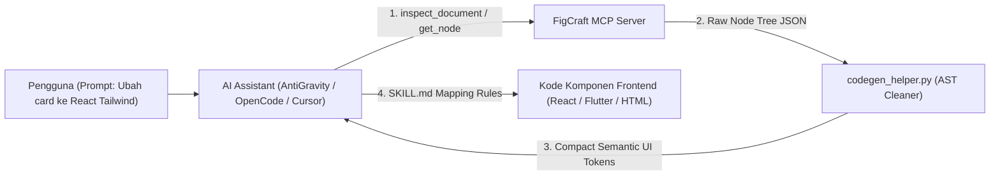

# Design Document: FigCraft Two-Way Design-to-Code Integration

**Status**: Proposed  
**Date**: 2026-11-17  
**Approach**: Approach 1 — Hybrid Mode (AST Cleaner Helper + AI Designer Skill)

---

## 1. Intent & The "Why"
Memungkinkan pengguna mengambil desain visual yang dibuat atau dipilih di kanvas FigCraft dan mengonversinya secara instan menjadi kode antarmuka produksi (React + Tailwind, Flutter, HTML/CSS, dll.) melalui AI assistant apa pun yang terhubung ke FigCraft MCP.

---

## 2. Goals, Non-Goals, and Anti-Goals

### Goals:
- Menyediakan helper Python ringan (`codegen_helper.py`) yang mengekstrak dan membersihkan node tree dari FigCraft via MCP (memangkas metadata internal mentah dan menyisakan layout semantik: flex, padding, gap, colors, typography, dan hierarki).
- Menyediakan skill `skills/figcraft-design-to-code/SKILL.md` yang mengajarkan AI pemetaan presisi dari token UI FigCraft ke framework frontend modern.
- Mendukung konversi multi-framework (React Tailwind, Flutter, Vue, dan semantic HTML/CSS).
- Memungkinkan verifikasi visual dengan membandingkan screenshot FigCraft terhadap render komponen kode.

### Non-Goals:
- Tidak membuat compiler monolitik kaku yang membatasi framework tertentu saja.
- Tidak mengubah file `.figcraft` secara langsung di tingkat binary/arsip.

### Anti-Goals:
- Jangan membebani context window AI dengan ratusan baris koordinat absolut mentah yang tidak dibutuhkan untuk layout responsif.

---

## 3. Constraints
- Menggunakan standard library Python (tanpa dependensi eksternal tambahan seperti numpy/pandas).
- Bekerja secara headless maupun attached melalui loopback MCP bridge yang sudah ada.

---

## 4. Approaches Considered

1. **Hybrid Mode: AST Cleaner Helper + AI Designer Skill (Dipilih)**
   - *Kenapa dipilih*: Paling hemat token, sangat fleksibel mendukung berbagai framework frontend, dan menghasilkan kode yang idiomatik dan mudah dibaca manusia.
2. **Skill-Only LLM Mapping**
   - *Trade-off*: Memakan terlalu banyak token karena LLM harus membaca seluruh dump JSON mentah termasuk koordinat yang tidak relevan.
3. **Deterministic Python Transpiler (`codegen.py`)**
   - *Trade-off*: Terlalu kaku, sulit diperluas ke framework lain, dan kode hasil transpiler seringkali tidak idiomatik.

---

## 5. Architectural Flow & Components

### Komponen yang Dibangun:
1. `codegen_helper.py` (di root `D:\Code\figcraft-mcp\`):
   - Menerima raw node JSON dari `get_node` atau `inspect_document`.
   - Mengubah properti FigCraft (`layout`, `mainAlign`, `crossAlign`, `gap`, `padding`, `cornerRadius`, `fills`, `fontSize`) menjadi token semantik ringkas (`flex`, `justify`, `items`, `p`, `gap`, `rounded`, `bg`, `text`).
2. `skills/figcraft-design-to-code/SKILL.md`:
   - Panduan terstruktur untuk AI dalam menerjemahkan token UI ke komponen React/Tailwind, Flutter, atau HTML.
   - Aturan penanganan responsif, ikon/emoji, dan ekstraksi warna hex.
3. Contoh Pengujian (`test_design_to_code.py`):
   - Mengambil salah satu card yang ada di kanvas FigCraft (misal Analytics Card atau Weather Widget) dan mengonversinya menjadi komponen React Tailwind sebagai bukti kerja (*proof-of-concept*).
